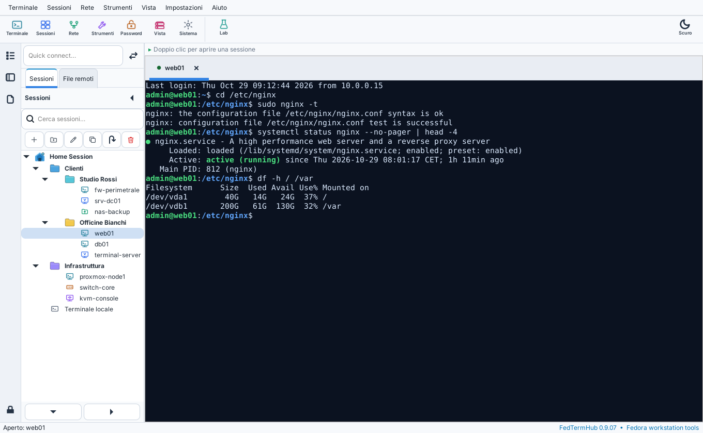
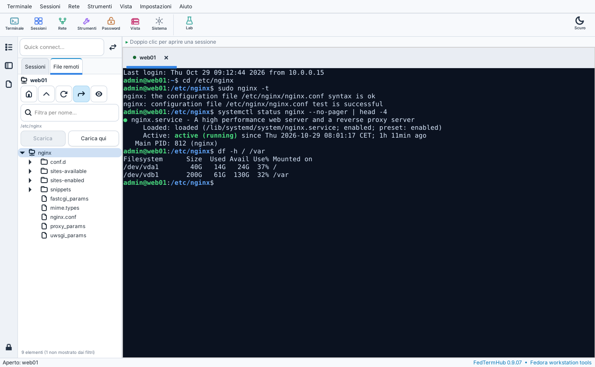

<!-- SPDX-FileCopyrightText: 2026 Crash
     SPDX-License-Identifier: GPL-3.0-or-later -->
# FedTermHub

[](https://github.com/Crash-FD01/FedTermHub/actions/workflows/ci.yml)
[](https://github.com/Crash-FD01/FedTermHub/releases/latest)
[](LICENSE)

**Terminali, SSH, desktop remoto e file in un'unica finestra, per chi amministra sistemi.**
FedTermHub riunisce terminali locali, sessioni SSH, desktop RDP e VNC, trasferimento file e un vault
cifrato per le credenziali, con le sessioni organizzate in cartelle. Gratuito e open source, per Fedora.

<picture>
  <source media="(prefers-color-scheme: dark)" srcset="docs/screenshots/principale-scuro.png">
  
</picture>

## Cosa fa

- 🗂️ **Sessioni in cartelle** — SSH, RDP, VNC, SFTP, seriale e terminale locale, con ricerca, command
  palette (**Ctrl+K**) e connessione rapida.
- 🖥️ **Terminale a riquadri** — layout divisibili, invio dello stesso comando a più server insieme,
  ricerca nello scrollback, URL apribili da tastiera.
- 📁 **File remoti che seguono il terminale** — fai `cd` nella shell e l'albero dei file si sposta con te;
  trascini i file per caricarli.
- 🪟 **Desktop remoto nativo** — motore RDP costruito su FreeRDP 3, con appunti bidirezionali anche per i
  file, cartella condivisa e schermo intero su qualsiasi monitor.
- 🔐 **Password Manager** — credenziali cifrate con AES-256-GCM, mai scritte nel file delle sessioni né
  sulla riga di comando dei processi.
- 🧰 **Strumenti di rete** — tunnel SSH, scansione di rete e porte, cattura pacchetti, server temporanei e
  un laboratorio Linux usa e getta su libvirt.

## Installazione

**Fedora 43 o più recente** — apri un terminale e incolla:

```bash
curl -fsSL https://crash-fd01.github.io/FedTermHub/setup.sh | sudo sh
```

Poi lo trovi nel menu delle applicazioni. Gli aggiornamenti arrivano con quelli del sistema
(`sudo dnf upgrade`).

Installazione a mano, sistemi immutabili, altre distribuzioni e compilazione dai sorgenti:
[guida completa](docs/GUIDA.md#installazione).

## Come si usa



1. **Crea una sessione** con **Ctrl+Shift+N**: finisce in fondo all'elenco, poi la trascini nella cartella
   che vuoi.
2. **Aprila** con un doppio clic. Le sessioni SSH mostrano accanto il pannello **File remoti**.
3. **Salva le password nel Password Manager**: le sessioni le usano senza che compaiano mai in chiaro.

Tutte le funzioni e le scorciatoie sono nella [guida](docs/GUIDA.md).

<br clear="right">

## Privacy e sicurezza

- Tutto resta sul tuo computer: nessun account, nessun dato inviato da FedTermHub.
- Le password non compaiono mai nella riga di comando dei processi: passano per variabile d'ambiente o
  per un file descriptor su memoria sigillata.
- Il vault usa AES-256-GCM con chiave derivata da PBKDF2-HMAC-SHA256 a 600.000 iterazioni; i file di
  configurazione hanno permessi `0600`.
- Il codice è pubblico e ogni pacchetto è costruito e firmato dalla [CI](.github/workflows) a partire da
  questo repository. Dettagli e segnalazioni: [SECURITY.md](SECURITY.md).

## Aiuto

- 📖 [Guida completa](docs/GUIDA.md): installazione, tutte le funzioni, scorciatoie, risoluzione dei
  problemi.
- 🐞 [Segnala un problema o proponi un'idea](https://github.com/Crash-FD01/FedTermHub/issues/new/choose).
- 🤝 [Contribuire](CONTRIBUTING.md) · 🔒 [Sicurezza](SECURITY.md)

## Licenza

[GPL-3.0-or-later](LICENSE) © 2026 Crash. Il motore RDP si collega a FreeRDP, distribuito con licenza
Apache 2.0 ([LICENSES/Apache-2.0.txt](LICENSES/Apache-2.0.txt)).

---

*English: FedTermHub is a free, open-source session manager for Linux system administrators: local
terminals, SSH, RDP and VNC desktops, SFTP file transfer and an encrypted credential vault in one GTK
window, with sessions organized in folders. Built for Fedora. The interface is currently in Italian; an
English translation is planned.*
