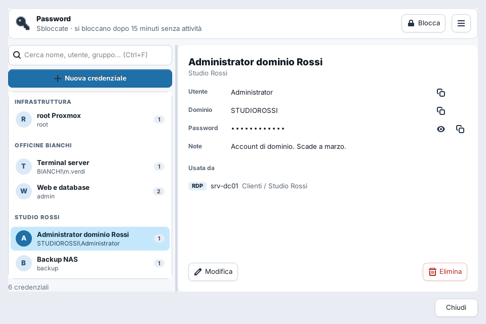

<!-- SPDX-FileCopyrightText: 2026 Crash
     SPDX-License-Identifier: GPL-3.0-or-later -->
# Guida di FedTermHub

- [Installazione](#installazione)
- [Primi passi](#primi-passi)
- [Terminale](#terminale)
- [SSH e file remoti](#ssh-e-file-remoti)
- [Tunnel SSH](#tunnel-ssh)
- [Desktop remoto RDP](#desktop-remoto-rdp)
- [VNC, Telnet e console seriale](#vnc-telnet-e-console-seriale)
- [Password Manager](#password-manager)
- [Strumenti di rete](#strumenti-di-rete)
- [Laboratorio Linux usa e getta](#laboratorio-linux-usa-e-getta)
- [Scorciatoie da tastiera](#scorciatoie-da-tastiera)
- [Dove sono i tuoi dati](#dove-sono-i-tuoi-dati)
- [Risoluzione dei problemi](#risoluzione-dei-problemi)
- [Limiti noti](#limiti-noti)

## Installazione

### Con un comando (consigliato)

Apri un terminale e incolla:

```bash
curl -fsSL https://crash-fd01.github.io/FedTermHub/setup.sh | sudo sh
```

Funziona su:

| Famiglia | Versioni | Gestore |
|---|---|---|
| Debian | 12, 13 e successive | apt |
| Ubuntu e derivate (Linux Mint, Pop!_OS, Zorin, elementary…) | Ubuntu 22.04+, Mint 21+ | apt |
| Fedora | 43 e successive, anche Silverblue, Kinoite e Bazzite | dnf, rpm-ostree |
| RHEL, AlmaLinux, Rocky Linux, CentOS Stream | 9 e 10 | dnf |
| openSUSE | Tumbleweed, Leap 16 | zypper |

su x86_64 e ARM64 (aarch64). Lo script aggiunge il repository firmato di
FedTermHub e installa il pacchetto; da lì gli aggiornamenti arrivano insieme a
quelli del sistema (`sudo apt upgrade`, `sudo dnf upgrade`, `sudo zypper update`
o il centro aggiornamenti del desktop). Leggilo pure prima di eseguirlo: fa solo
quello che c'è scritto.

Per toglierlo, insieme al repository:

```bash
curl -fsSL https://crash-fd01.github.io/FedTermHub/setup.sh | sudo sh -s -- --remove
```

Le tue sessioni restano in `~/.config/fedtermhub`.

**Il motore RDP.** Fuori da Fedora il desktop remoto arriva con il pacchetto
`fedtermhub-rdp`, che porta con sé la sua copia di FreeRDP 3 in
`/usr/libexec/fedtermhub/lib`: Ubuntu 22.04, Mint 21 e RHEL 9 non hanno
FreeRDP 3, e le altre distribuzioni ne hanno versioni diverse. Così il desktop
remoto funziona allo stesso modo ovunque e la FreeRDP del sistema (quella di
`xfreerdp`) non viene toccata. Gli aggiornamenti di sicurezza di FreeRDP
arrivano con le versioni di FedTermHub. Su Fedora si usa la FreeRDP della
distribuzione.

### A mano

Debian, Ubuntu, Mint:

```bash
sudo install -d -m 755 /etc/apt/keyrings
sudo curl -fsSL https://crash-fd01.github.io/FedTermHub/fedtermhub.asc -o /etc/apt/keyrings/fedtermhub.asc
echo "deb [signed-by=/etc/apt/keyrings/fedtermhub.asc] https://crash-fd01.github.io/FedTermHub/apt ./" \
  | sudo tee /etc/apt/sources.list.d/fedtermhub.list
sudo apt update && sudo apt install fedtermhub
```

Fedora:

```bash
sudo rpm --import https://crash-fd01.github.io/FedTermHub/fedtermhub.asc
sudo curl -fsSL https://crash-fd01.github.io/FedTermHub/fedtermhub.repo -o /etc/yum.repos.d/fedtermhub.repo
sudo dnf install fedtermhub
```

Sui sistemi immutabili (Silverblue, Kinoite, Bazzite): come sopra, poi
`rpm-ostree install fedtermhub` e riavvia.

RHEL, AlmaLinux, Rocky: come Fedora, ma con il file
`https://crash-fd01.github.io/FedTermHub/fedtermhub-universal.repo`.

openSUSE:

```bash
sudo rpm --import https://crash-fd01.github.io/FedTermHub/fedtermhub.asc
sudo zypper addrepo --refresh https://crash-fd01.github.io/FedTermHub/fedtermhub-universal.repo
sudo zypper install fedtermhub
```

### Dalle release

Ogni [release](https://github.com/Crash-FD01/FedTermHub/releases) contiene i
pacchetti (`.deb`, `.rpm` per Fedora con `.fcNN` nel nome, `.rpm` per RHEL e
openSUSE), il tarball dei sorgenti e il file `SHA256SUMS` firmato. Servono
sempre due pacchetti fuori da Fedora: `fedtermhub` e `fedtermhub-rdp` della tua
architettura. Senza repository non ricevi gli aggiornamenti automatici.

### Dai sorgenti

Per Arch, Manjaro, EndeavourOS e le distribuzioni senza pacchetti, o per
provare una versione in sviluppo:

```bash
git clone https://github.com/Crash-FD01/FedTermHub.git
cd FedTermHub
./install.sh            # installa nella cartella utente, senza pacchetto
```

`install.sh` riconosce la distribuzione e installa le dipendenze con `pacman`,
`apt`, `dnf` o `zypper`. Il motore RDP viene compilato contro la FreeRDP 3 del
sistema quando c'è (Arch, Fedora, Debian 13, Ubuntu 24.04, Tumbleweed);
altrimenti `install.sh` ne compila una copia (qualche minuto) e la mette accanto
al motore. Opzioni: `--with-servers` e `--with-lab` per i server degli
Strumenti di rete e per il laboratorio, `--no-deps` se le dipendenze le hai già,
`--bundled-freerdp` per usare comunque la copia compilata. Per toglierlo:
`./uninstall.sh`.

Su Fedora puoi anche costruire e installare un RPM: `bash COMPILA-RPM.sh`.

### Requisiti

- Python 3.9 o più recente con PyGObject
- GTK 3 e VTE 2.91 (0.76 o più recente per gli appunti OSC 52)
- FreeRDP 3 per il desktop remoto nativo (inclusa nei pacchetti fuori da Fedora)
- OpenSSH client per SSH e SFTP
- Facoltativi, attivano le funzioni corrispondenti: `wl-clipboard` o `xclip`
  (incollare su Linux i file copiati in una sessione RDP), `nmap`, `tcpdump`,
  `sshpass`, `tigervnc`, `python3-pyserial`, `python3-winrm`, libvirt e
  `virt-install` (laboratorio). I pacchetti li propongono come «consigliati»;
  quando ne manca uno, FedTermHub mostra il comando per installarlo sulla tua
  distribuzione.

## Primi passi

Le sessioni stanno nel pannello **Sessioni**, a sinistra, organizzate in
cartelle dentro **Home Session**.

- **Nuova sessione** (`Ctrl+Shift+N`): la sessione creata finisce **in fondo
  all'elenco**, sotto tutte le cartelle, e viene selezionata. Trascinala nella
  cartella che preferisci.
- **Nuova cartella**: viene creata dentro la cartella selezionata. Il colore
  della cartella si cambia dal menu contestuale.
- **Connessione rapida** (`Ctrl+L`): scrivi nel campo in alto e premi Invio,
  senza salvare una sessione. Accetta `utente@host`, `utente@host:2222`,
  `utente@[fe80::1]:22` (IPv6 tra parentesi quadre), `rdp:host:3390`,
  `vnc:host` e `serial:/dev/ttyUSB0@9600`.
- **Command palette** (`Ctrl+K`): cerca una sessione per nome e aprila.
- **Importa / Esporta**: menu **Sessioni** oppure menu contestuale.
  *Esporta tutte le sessioni*, *Esporta la selezione*, *Importa sessioni nella
  cartella selezionata* (legge anche i file delle versioni vecchie) e
  *Sostituisci tutte le sessioni con un file*. Le esportazioni non contengono
  password. Le sessioni importate vengono controllate prima di connettersi:
  una sessione con dati non validi viene rifiutata.
- La finestra di una sessione non salva se manca l'host o la porta non è un
  numero: resta aperta e dice cosa correggere.
- **Apri tutte le sessioni** di una cartella chiede conferma quando sono più
  di cinque.

Doppio clic su una sessione per aprirla in una scheda.

## Terminale

Il terminale è basato su VTE, lo stesso componente di GNOME Terminal e Ptyxis.

- **Riquadri**: dividi con `Ctrl+Shift+O` (affiancati) o `Ctrl+Shift+E` (sopra e
  sotto); `Ctrl+Shift+L` passa da un layout all'altro (stack, tall, fat, grid).
- **Broadcast** (`Ctrl+Shift+P`): quello che scrivi va in tutti i riquadri
  insieme. Utile per lanciare lo stesso comando su più server.
- **Hints** (`Ctrl+Shift+H`): assegna una lettera a ogni URL visibile e lo apri
  da tastiera.
- **Ricerca** nello scrollback con `Ctrl+Shift+F`.
- **Chiusura**: una shell locale o uno strumento rapido chiude la sua scheda
  quando termina (`exit`, oppure Invio dove lo chiede). Una sessione SSH, SFTP
  o seriale si chiude con `exit`; se invece la connessione cade la scheda resta
  aperta con ⟳ per riconnettere. `Ctrl+Shift+W` sull'ultimo riquadro chiude la
  scheda. Le sessioni *Comando* restano aperte per leggere l'output.
- **MultiExec** (menu Terminale): scrivi un comando e scegli a quali schede
  mandarlo; le sessioni SSH sono già spuntate.
- **Appunti**: `Ctrl+Shift+C` e `Ctrl+Shift+V`. I programmi remoti possono
  copiare negli appunti locali con OSC 52 (vim, tmux).
- **Le combinazioni `Ctrl+lettera` appartengono al terminale** quando il
  terminale ha il fuoco: `Ctrl+W` in bash cancella una parola, `Ctrl+K` in nano
  taglia la riga, `Ctrl+B` è il prefisso di tmux. Le scorciatoie
  dell'applicazione con `Ctrl` senza `Shift` funzionano quando il fuoco è
  altrove, e restano disponibili dal menu.
- **Diagnostica terminale** (menu contestuale): confronta la dimensione del
  terminale vista da VTE, dal kernel e da ncurses. Se un'applicazione a schermo
  intero disegna male, è il primo controllo da fare.

## SSH e file remoti

Aprendo una sessione SSH compare la scheda **File remoti** accanto a Sessioni.

- **Segue la cartella del terminale**: quando fai `cd` nella shell, l'albero si
  sposta nella stessa cartella. Funziona con bash e zsh: all'apertura della
  sessione FedTermHub configura la shell remota perché comunichi la cartella
  corrente (sequenza OSC 7), senza toccare i suoi file di configurazione.
  L'interruttore con la freccia nella barra ferma l'inseguimento quando vuoi
  navigare a mano. Su apparati di rete senza bash o zsh non è disponibile.
- **File nascosti**: esclusi per impostazione predefinita; l'interruttore con
  l'occhio o `Ctrl+H` li mostra. La barra di stato dice quanti elementi sono
  esclusi dai filtri.
- **Filtra per nome**: restringe la cartella aperta; le sottocartelle restano
  visibili per poterci entrare.
- **Caricare**: trascina file o cartelle dal file manager sopra una cartella
  dell'albero, oppure usa *Carica qui*.
- **Scaricare**: doppio clic su un file, oppure *Scarica*.

Il browser usa il client OpenSSH di sistema e riusa la connessione della
sessione quando possibile (multiplexing), quindi non chiede di nuovo la
password.

## Tunnel SSH

**Gestore tunnel** (`Ctrl+Shift+T`): tunnel locali, remoti e proxy SOCKS
dinamici, con verifica della connessione, avvio automatico, riconnessione e log.
I tunnel restano attivi anche chiudendo la finestra del gestore.

## Desktop remoto RDP

FedTermHub usa un motore RDP nativo costruito su FreeRDP 3, che disegna la
sessione dentro la scheda o in una finestra indipendente.

- **Ridimensionamento dinamico**: la risoluzione remota segue la finestra.
- **Schermo intero** su un monitor a scelta (`F11`); la barra di controllo in
  alto si trascina dove vuoi e torna al suo posto con un doppio clic.
- **Appunti bidirezionali**, testo e file. Per incollare su Linux i file copiati
  in Windows serve `wl-clipboard` (Wayland) o `xclip` (X11).
- **Cartella condivisa**: una cartella locale che compare in Esplora risorse
  come unità di rete. Trascinare file sulla sessione li copia lì.
- **Gestisci sessioni**: disconnetti, chiudi la sessione o manda un messaggio
  agli utenti di un server Windows (richiede `python3-winrm`).
- Lo stato di Bloc Num e Bloc Maiusc viene sincronizzato entrando nella scheda.

Se il motore nativo non è disponibile, FedTermHub ripiega su `xfreerdp`.

## VNC, Telnet e console seriale

- **VNC** apre `vncviewer` (TigerVNC) con i parametri della sessione. Nel
  campo *Display/porta* un numero piccolo è un display (`1` = porta 5901),
  un numero da 100 in su è una porta (`5901`).
- **Telnet**: per switch, router, UPS e apparati che non hanno SSH. Crea una
  sessione Telnet oppure scrivi `telnet:host` (o `telnet:host:porta`) nella
  connessione rapida. Usa il client `telnet` del sistema; il traffico non è
  cifrato. Per uscire: `Ctrl+]` e poi `quit`.
- **Seriale**: indica il dispositivo (`/dev/ttyUSB0`) e la velocità. Serve
  `python3-pyserial` e l'appartenenza al gruppo `dialout`.

## Password Manager

Pulsante **Password** nella barra, oppure `Ctrl+Shift+V` quando il fuoco non è
nel terminale. La prima volta scegli la master password: cifra tutte le
credenziali e non viene salvata da nessuna parte.

<picture>
  <source media="(prefers-color-scheme: dark)" srcset="screenshots/password-scuro.png">
  
</picture>

**Come è organizzato.** A sinistra l'elenco, raggruppato e in ordine
alfabetico; a destra la credenziale scelta, con un pulsante Copia accanto a
utente, dominio e password e l'elenco delle sessioni che la usano. Il numero
accanto a ogni voce dice quante sessioni la usano.

**Gruppi.** Il gruppo è un nome libero, di solito il cliente. Se hai
credenziali senza gruppo usate da sessioni che stanno in una cartella, la
finestra propone di raggrupparle con il nome di quella cartella. Una password
RDP salvata dalla finestra di connessione prende da sola il gruppo della
cartella della sessione.

**Collegare una credenziale a una sessione.** Nella finestra della sessione
scegli la credenziale nel campo *Credenziale*: FedTermHub si collega senza
chiedere la password, e nel file delle sessioni non finisce mai una password.

| Tasto | Nella finestra Password |
|---|---|
| `Ctrl+F` | Cerca (nome, utente, dominio, gruppo, note; anche più parole) |
| `Ctrl+N` | Nuova credenziale |
| `Ctrl+C` | Copia la password della credenziale selezionata |
| `Ctrl+B` | Copia l'utente (`DOMINIO\utente` per gli account di dominio) |
| `Canc` | Elimina (chiede conferma e dice quali sessioni la usano) |

Le password copiate si cancellano dagli appunti dopo 30 secondi (si cambia
nelle Impostazioni). Nella modifica, **Genera** crea una password di 20
caratteri senza caratteri che si confondono (0/O, 1/l).

**Sicurezza.** Le credenziali sono cifrate con AES-256-GCM; la chiave deriva
dalla master password con PBKDF2-HMAC-SHA256 a 600.000 iterazioni. Il Password
Manager si blocca dopo un periodo di inattività (configurabile nelle
impostazioni) oppure resta sbloccato finché il programma è aperto, se lo
scegli quando inserisci la master password. Dal menu ☰ della finestra cambi
la master password ed esporti o importi un backup cifrato.

**La master password non si recupera.** Se la perdi, le credenziali salvate
sono perse: esporta un backup cifrato ogni tanto e conservalo con la sua
password.

## Strumenti di rete

Dal menu **Rete**:

- **Network scanner** e **port scanner** (`nmap`; l'ARP con privilegi mostra
  MAC e produttore). Dal port scanner *Crea sessione dal servizio* apre una
  sessione SSH, RDP, VNC o Telnet con la porta trovata (un SSH sulla 2222
  diventa una sessione sulla 2222).
- **Cattura pacchetti** (`tcpdump`): ogni cattura va in un file nuovo; si ferma
  senza chiedere di nuovo la password.
- **Wake-on-LAN**: propone il broadcast delle reti a cui sei collegato (per
  esempio `192.168.1.255`), che funziona meglio di `255.255.255.255`.
- **Porte in ascolto**, con il programma che usa ogni porta.
- **Server locali** (SSH, FTP, TFTP, Telnet, HTTP, NFS, VNC) da avviare al volo
  per un intervento. Il server HTTP propone la cartella *Pubblici*, non tutta
  la home.
- **Connessione Telnet** e strumenti rapidi (ping, traceroute, DNS, porta TCP,
  route, socket aperti).

Le operazioni che richiedono privilegi chiedono l'autorizzazione con Polkit
**una volta sola** per ogni azione (prima, applicare più cartelle FTP la
chiedeva per ogni comando).

I server si adattano alla distribuzione: nomi dei pacchetti e dei servizi
(`sshd` su Fedora, `ssh` su Debian e Ubuntu), cartella TFTP (`/var/lib/tftpboot`
su Fedora e RHEL, `/srv/tftp` su Debian e Ubuntu, `/srv/tftpboot` su openSUSE) e
firewall (`firewalld`, oppure `ufw` su Ubuntu e Mint). Debian e Ubuntu non hanno
un server Telnet avviato da systemd: lì la voce è disattivata.

## Laboratorio Linux usa e getta

**Lab** crea una macchina virtuale a partire da un'immagine cloud (QCOW2): la
macchina lavora su una copia temporanea, l'immagine originale resta intatta e
tutto viene eliminato chiudendo la console.

Servono `libvirt-daemon-kvm`, `libvirt-client`, `virt-install`, `virt-viewer` e
`qemu-img`. Le immagini cloud di Debian e Fedora usano la console seriale: se la
finestra grafica resta ferma sui messaggi del kernel, la macchina è avviata e
aspetta su `virsh -c qemu:///session console <nome>`.

## Scorciatoie da tastiera

| Tasti | Azione |
|---|---|
| `Ctrl+K` | Command palette: cerca e apri una sessione |
| `Ctrl+Shift+N` | Nuova sessione |
| `Ctrl+L` | Connessione rapida |
| `Ctrl+T` | Nuovo terminale locale |
| `Ctrl+W` | Chiudi la scheda |
| `Ctrl+B` | Mostra o nascondi il pannello laterale |
| `Ctrl+H` | File remoti: mostra i file nascosti |
| `Ctrl+,` | Impostazioni |
| `Ctrl+Shift+T` | Gestore tunnel |
| `Ctrl+Shift+V` | Password Manager (fuori dal terminale) |
| `F11` | Schermo intero |

Le scorciatoie con `Ctrl` senza `Shift` valgono quando il fuoco **non** è nel
terminale. Dentro il terminale:

| Tasti | Azione |
|---|---|
| `Ctrl+Shift+C` / `Ctrl+Shift+V` | Copia / Incolla |
| `Ctrl+Shift+Invio` | Nuovo riquadro |
| `Ctrl+Shift+O` / `Ctrl+Shift+E` | Dividi affiancato / sopra e sotto |
| `Ctrl+Shift+L` | Cambia layout dei riquadri |
| `Ctrl+Shift+[` / `Ctrl+Shift+]` | Riquadro precedente / successivo |
| `Ctrl+Shift+W` | Chiudi il riquadro (l'ultimo chiude la scheda) |
| `Ctrl+Shift+P` | Broadcast dell'input |
| `Ctrl+Shift+H` | Hints: apri un URL da tastiera |
| `Ctrl+Shift+F` | Cerca nello scrollback |
| `Ctrl` `+` / `-` / `0` | Zoom del carattere |

## Dove sono i tuoi dati

Tutto resta sul tuo computer; FedTermHub non manda dati da nessuna parte.

| Percorso | Contenuto |
|---|---|
| `~/.config/fedtermhub/sessions.json` | Sessioni e cartelle (senza password) |
| `~/.config/fedtermhub/vault.json` | Credenziali cifrate |
| `~/.config/fedtermhub/tunnels.json` | Tunnel SSH |
| `~/.config/fedtermhub/settings.json` | Impostazioni (anche la lingua) |
| `~/.cache/fedtermhub/fedtermhub.log` | Log dell'applicazione |
| `~/.cache/fedtermhub/labs/` | Dischi temporanei del laboratorio |

I file di configurazione hanno permessi `0600` e vengono scritti in modo
atomico.

## Lingua

FedTermHub è in italiano e in inglese. Con **Automatica** (il valore iniziale)
segue la lingua del sistema: italiano se il sistema è in italiano, inglese in
tutti gli altri casi. Per sceglierla a mano: **Impostazioni → Interfaccia →
Lingua**. La nuova lingua vale dal riavvio successivo del programma.

Per una sola volta, senza toccare le impostazioni:

```bash
FEDTERMHUB_LANGUAGE=en fedtermhub
```

Le traduzioni stanno in `fedtermhub/locale/en.po`, un normale file gettext che
si apre con Poedit o con un editor di testo. Un testo non ancora tradotto
compare in italiano. Comandi, nomi di protocolli e messaggi tecnici di
FreeRDP restano volutamente uguali in tutte le lingue.

## Risoluzione dei problemi

- **nano, htop o vim disegnano male**: menu contestuale del terminale ›
  *Diagnostica terminale*. Le tre dimensioni mostrate devono coincidere.
- **Su un apparato di rete i programmi a schermo intero non funzionano**: molti
  apparati hanno un database terminfo ridotto e non conoscono `xterm-256color`.
  Avvia FedTermHub con `FEDTERMHUB_TERM=xterm fedtermhub`.
- **RDP non si connette**: il pulsante del log nella barra della sessione
  mostra i messaggi di FreeRDP (la password è mascherata). *Diagnostica
  connessione* prova raggiungibilità, porta e certificato.
- **Incollare in Linux file copiati in Windows non fa nulla**: installa
  `wl-clipboard` (Wayland) o `xclip` (X11).

## Limiti noti

- Le lingue disponibili sono italiano e inglese; il cambio di lingua richiede
  il riavvio del programma.
- Il motore RDP nativo richiede FreeRDP 3: su sistemi con FreeRDP 2 si usa il
  ripiego `xfreerdp`.
- L'inseguimento della cartella nei file remoti richiede bash o zsh sul server.
- I pacchetti sono costruiti per x86_64; su altre architetture si installa dai sorgenti.
